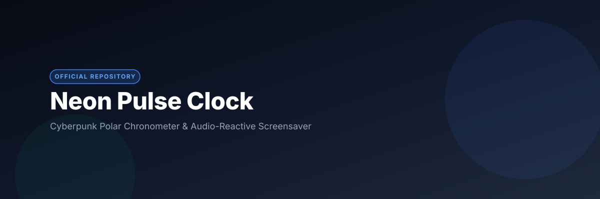
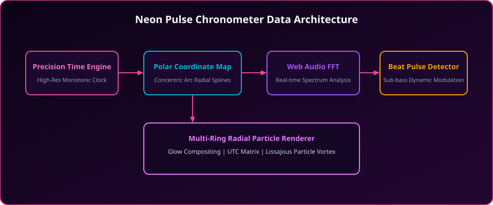
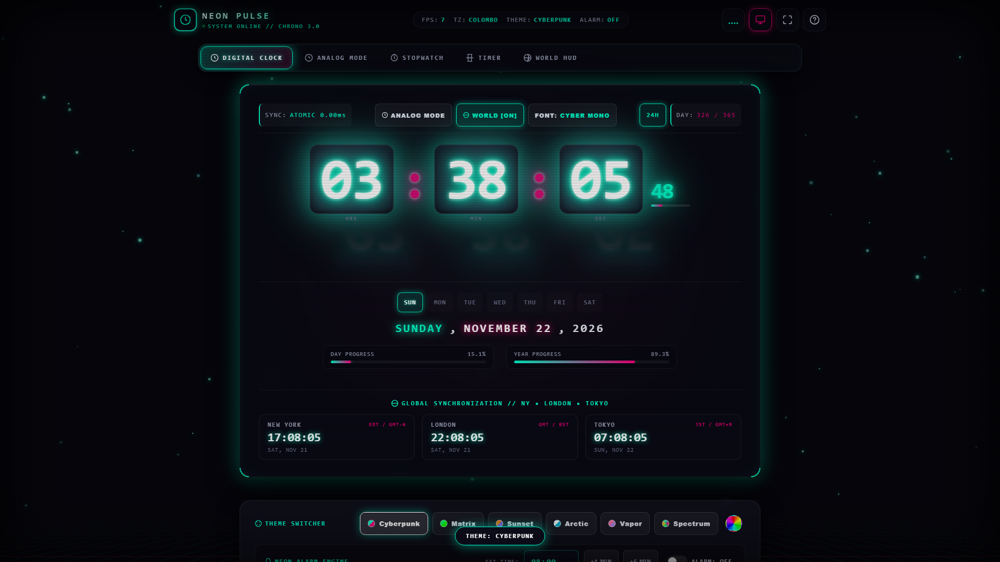

# Neon Pulse Clock

> Cyberpunk Polar Chronometer & Audio-Reactive Screensaver

   



## 📌 Executive Overview
A futuristic concentric polar chronometer that synchronizes precision timekeeping with audio-reactive visual pulses, Lissajous frequency curves, and real-time world timezone mapping.

---

## 🏛 System Architecture
The following diagram highlights the internal computation pipeline, data transformations, and rendering passes:



---

## 📷 Live Application Interface
Below is an authentic 1080p high-resolution capture of the live running interface:



---

## 🔬 Technical Deep-Dive
### Core Technical Specifications
- **Concentric Polar Chronometer:** Renders milliseconds, seconds, minutes, hours, weekdays, and months on independent radial arcs with continuous trigonometric interpolation.
- **Audio-Reactive Visualizer:** Integrates Web Audio Analyzer node (1024-point FFT) to modulate ring thickness, particle burst rate, and neon glow radius based on real-time acoustic amplitudes.
- **World Timezone Calculator:** Computes and overlays UTC offsets across major global hubs (London, Tokyo, New York, Sydney) with live daylight transitions.
- **Screensaver Engine:** Idle detection subsystem automatically triggers particle swirl fields and Lissajous orbit oscillations after period of user inactivity.

---

## 🚀 Quick Start Guide

### Zero-Dependency Launch
This project is built as a self-contained, high-performance HTML5 application with zero runtime dependencies.

1. **Clone the repository:**
   ```bash
   git clone https://github.com/royalodi/neon-pulse-clock.git
   cd neon-pulse-clock
   ```

2. **Launch directly in any modern browser:**
   ```bash
   # Windows (PowerShell)
   Start-Process index.html

   # macOS / Linux
   open index.html || xdg-open index.html
   ```

---

## 📄 License
This project is distributed under the **MIT License**.


---

## 👨‍💻 Author & Lead Maintainer

<table>
  <tr>
    <td align="center" width="150" valign="middle">
      <a href="https://github.com/royalodi">
        
      </a>
      <br /><br />
      <b>Royal Odi</b><br />
      <sub><i>Full-Stack Engineer</i></sub>
    </td>
    <td valign="top">
      <p>
        Designed, engineered, and maintained by <b>Royal Odi</b>. Full-Stack Engineer focused on building scalable web architectures, robust backend systems, and responsive, high-performance digital experiences.
      </p>
      <p>
        <a href="https://github.com/royalodi"></a>
        <a href="mailto:royalodi.dev@gmail.com"></a>
        <a href="https://github.com/royalodi?tab=repositories"></a>
      </p>
    </td>
  </tr>
</table>

